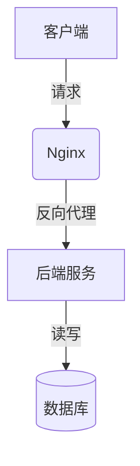

> **一句话导读：** 本文将带你深入理解 [核心技术点]，解决 [痛点问题]，预计阅读时间 X 分钟。

## 🎯 1. 背景与痛点
*简述在什么场景下遇到了什么问题，为什么要写这篇文章。*

- **业务场景：** 比如“在分布式高并发的订单系统中……”
- **遇到问题：** 比如“数据库连接池爆满，导致请求超时……”

## 💡 2. 核心概念 / 架构设计
*在进入代码之前，先用通俗的语言或图解说清楚原理。*

> 💡 **提示：** 如果有流程图，可以用 Mermaid 语法直接在 GitHub 中渲染：



## 💻 3. 核心代码实现 / 配置步骤
*展示最核心的代码片段，切忌贴大段无用代码。保证代码有高亮和注释。*

```go
// 举例：Go语言高并发处理片段
func processRequests(ctx context.Context, requests <-chan Request) {
    for req := range requests {
        go func(r Request) {
            // 处理核心业务逻辑
            fmt.Printf("Processing request: %v\n", r.ID)
        }(req)
    }
}
```

### 🔍 关键点解析：
1. **行 X：** 这里使用了 `context` 来控制生命周期，防止协程泄漏。
2. **行 Y：** 注意这里的匿名函数闭包问题，需要显式传递参数。

## ⚡ 4. 性能测试 / 效果对比
*用数据说话，展示优化前后的对比。*

| 指标 | 优化前 | 优化后 | 提升幅度 |
| :--- | :--- | :--- | :--- |
| **QPS** | 1,200 | 8,500 | 🚀 608% |
| **P99 延迟** | 450ms | 35ms | 📉 92.2% |

## ❌ 5. 常见踩坑点 (Gotchas)
*你在写这个功能/调试时，踩过哪些让人抓狂的坑？*

- 🛑 **内存泄漏：** 记得在使用完后关闭 `response.Body`，否则会导致内存持续上升。
- ⚠️ **版本兼容：** 该特性仅在 v1.22 及以上版本支持。

## 📝 6. 总结与展望
*一两句话收尾。*

本文通过 [方法] 解决了 [问题]。下一步计划引入 [新技术] 进一步优化。如果你有更好的方案，欢迎在评论区/Issue 中讨论！

---

**参考资料：**
- [1] [官方文档链接](https://example.com)
- [2] [某篇优秀的英文博客](https://example.com)
